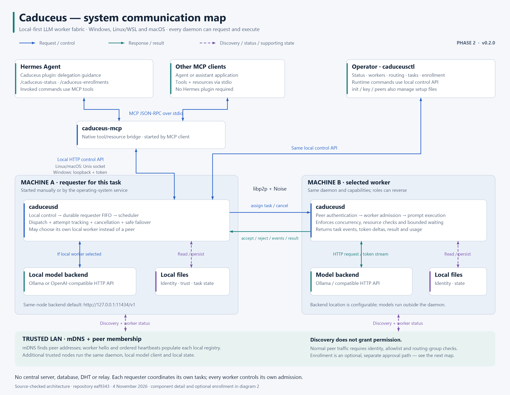
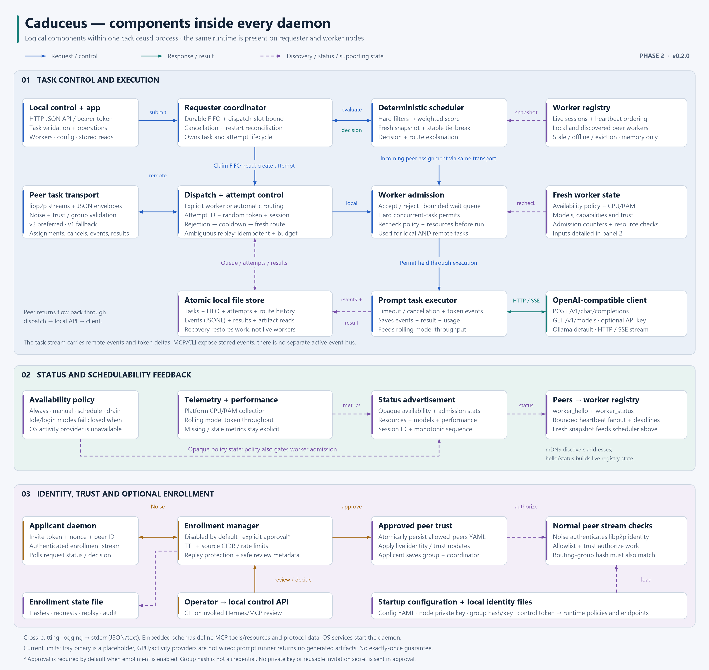

# Architecture

Caduceus uses three processes:

```text
MCP client -> caduceus-mcp -> local control API -> caduceusd -> libp2p LAN workers -> OpenAI-compatible backend
```

`caduceusd` owns libp2p identity, mDNS discovery, worker registry, task execution, task storage, and local control. `caduceus-mcp` is a stdio JSON-RPC MCP bridge. `caduceusctl` is a human CLI over the same control API.

On Linux and macOS the control API defaults to an HTTP server over a Unix socket. On Windows it defaults to loopback HTTP with a random local bearer token stored in the user data directory.

## System communication map

This view shows how Hermes, other MCP clients, and the CLI reach Caduceus,
how daemons exchange tasks and results, and how model backends, local files,
and LAN discovery fit together. Every daemon can both request and execute work.



[Scalable SVG](diagrams/caduceus-system.svg) · [High-resolution PNG](diagrams/caduceus-system.png)

## Components inside every daemon

This view expands task coordination, routing, admission, execution, storage,
and the status feedback that drives worker selection. It also shows identity,
peer trust, and the optional enrollment approval path. The panels describe
components within the same daemon, rather than separate services.



[Scalable SVG](diagrams/caduceus-components.svg) · [High-resolution PNG](diagrams/caduceus-components.png)

The diagrams describe the Phase 2 implementation (v0.2.0), checked against
repository revision `eaf9343` on 4 November 2026. Optional and unfinished
features are labeled in the diagrams.
